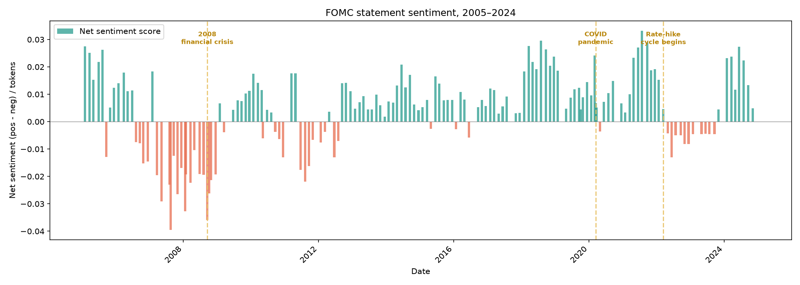
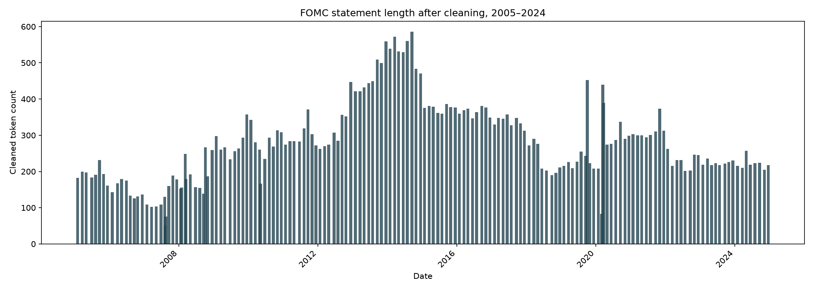

# Sentiment and Verbosity in Federal Reserve Statements

Dictionary-based text analysis of 169 FOMC post-meeting statements (February 2005 – December 2024). It measures
how the tone and length of US monetary-policy communication changed over time and how both relate to major
macroeconomic events.

**Tools:** Python · pandas · NLTK (tokenisation, lemmatisation) · regex · Matplotlib

## Question

Do central bankers sound gloomier, and say more, when the economy is in trouble?

## Approach

1. **Cleaning pipeline:** lower-casing, regex removal of punctuation and numbers, tokenisation, stop-word
   removal, and lemmatisation. Each step is justified in the notebook. Average statement length falls from 440
   raw words to 279 cleaned tokens.
2. **Financial sentiment dictionary:** the [Loughran–McDonald](https://sraf.nd.edu/loughranmcdonald-master-dictionary/)
   word lists rather than a general lexicon. Words like *risk* or *liability* are negative in everyday English
   but neutral in financial writing.
3. **Net sentiment** = (positive hits − negative hits) / cleaned tokens, so the score is comparable across
   statements of very different lengths.
4. **Time series** of sentiment and length, annotated with the 2008 financial crisis, COVID-19 and the 2022
   rate-hike cycle.

## Findings



- **The Fed's tone is close to neutral on average** (mean score 0.004, range −0.040 to 0.033). This is consistent
  with careful wording that avoids unsettling markets.
- **2007–2009 is the most negative stretch** of the sample. The lowest scores come as the financial crisis builds
  and around the Lehman collapse.
- **COVID-19 brings only a brief negative reading.** Sentiment turns positive again quickly as emergency support
  and the recovery take hold.
- **The 2022–23 tightening cycle** brings a run of negative statements, which clears in 2024.



| Period | Statements | Avg. cleaned tokens | Avg. sentiment |
|---|---|---|---|
| 2005–07 | 26 | 151 | −0.001 |
| 2008–11 | 36 | 255 | −0.005 |
| 2012–16 | 40 | 412 | +0.006 |
| 2017–19 | 25 | 272 | +0.013 |
| 2020–21 | 18 | 299 | +0.014 |
| 2022–24 | 24 | 225 | +0.004 |

- **Statements got much longer after 2008** and peaked in 2013–14 at about 580 tokens, during the era of explicit
  forward guidance. Shocks such as March 2020 also produce sharp one-off spikes in length.
- **Verbosity and tone only partly move together.** Length rises with crises, but the longest statements
  (2012–16) have neutral-to-positive tone. The correlation between length and sentiment is weak (0.26).

## Run it

```bash
pip install -r requirements.txt
jupyter notebook fomc_sentiment.ipynb
```

`data/FOMC_statements.csv` (public Federal Reserve statements) and `data/stopwords.csv` are included. The
Loughran–McDonald word lists are **not redistributed** here. Download the Master Dictionary from the
[Notre Dame SRAF site](https://sraf.nd.edu/loughranmcdonald-master-dictionary/), and save its positive and
negative words as `data/positive_words.csv` and `data/negative_words.csv`, each with a single column named
`positive_words` or `negative_words` respectively.

## About

This started as coursework for *Methods for Data Analytics II* (BSc Economics and Data Analytics, University of
Leicester, 2025/26) and was reworked into a standalone portfolio notebook. The analysis and code are my own; the
notebook was restructured for presentation with help from Claude Code.

**Yash Karavadra** · [LinkedIn](https://www.linkedin.com/in/yash-karavadra-88619b330/)
